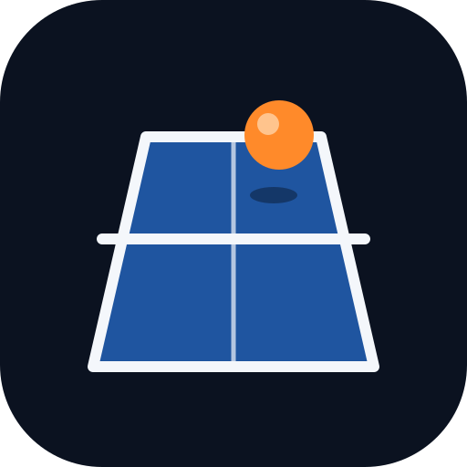
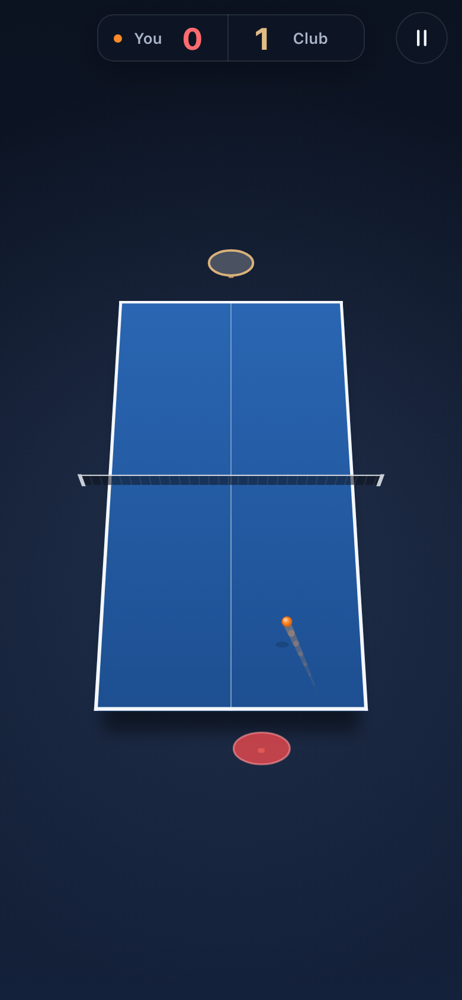
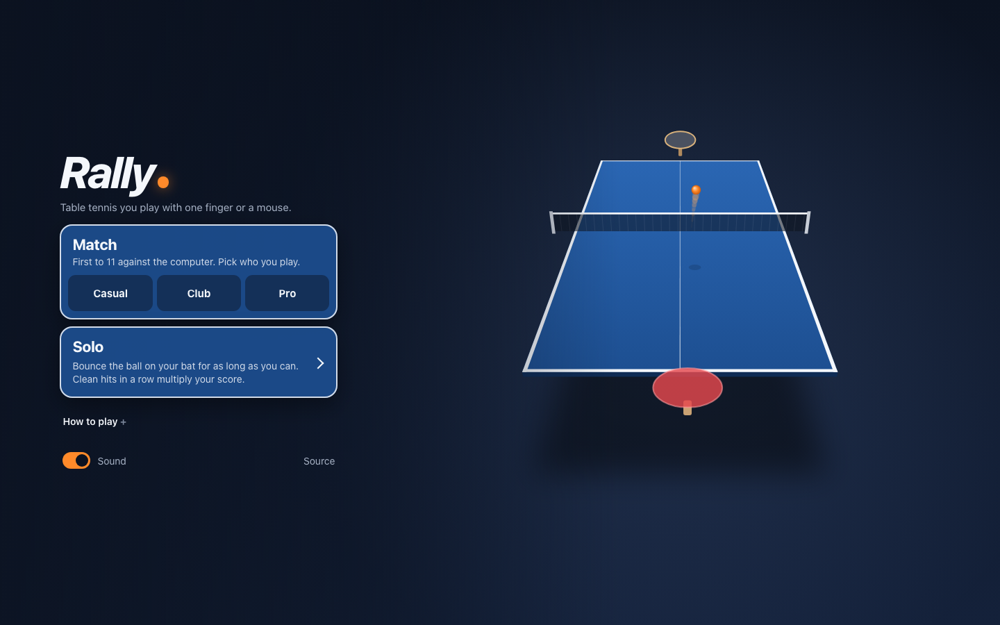

<p align="center">
  
</p>

<h1 align="center">Rally</h1>

<p align="center">
  Table tennis in the browser: a solo game against a wall, and matches to eleven against a computer opponent that reads the ball the way a person does.
</p>

<p align="center">
  <a href="https://github.com/AshwinSathian/rally/actions/workflows/ci.yml"></a>
  <a href="LICENSE"></a>
  
  
</p>

<p align="center">
  <a href="https://rally.ashwinsathian.com"><b>Play it at rally.ashwinsathian.com</b></a>
</p>

<p align="center">
  
  &nbsp;
  
</p>

## Modes

**Match.** First to 11, win by two. Service changes every two points, and every point from 10–10. The opponent comes in three levels, Casual, Club and Pro, and your record against each is kept on the device. A shot that lands off the side of the table loses the point; so does a ball you can't reach.

**Solo.** The far end of the table is a wall and the sides have rails. Keep the ball off the floor. Every return is a point, and hitting the lit patch on the wall is worth two more, after which it moves. The ball speeds up with each return.

The last two seconds of a game play back in slow motion before the result.

## Controls

| | Touch | Mouse | Keyboard |
|---|---|---|---|
| Move the paddle | Drag anywhere | Move | Arrow keys or WASD |
| Serve | Tap | Click | Space or Enter |
| Pause | Pause button | Pause button | Escape or P |

Touch moves the paddle by however far your finger moves, so your finger can rest anywhere and never covers the paddle. The mouse puts the paddle where the pointer is.

**Aiming.** Where the ball meets your paddle decides where it lands across the table: the middle sends it to the middle, and the last tenth at either end sends it off the side. Pushing forward as you hit adds pace. Moving sideways as you hit adds spin, and the ball curves.

## How it's built

TypeScript and Vite with no runtime dependencies. The build inlines everything into one HTML file of about 15 KB gzipped; there are no fonts, images or audio files to fetch. Sounds are synthesised with Web Audio.

**Physics** (`src/sim.ts`) runs at a fixed 240 Hz in metres and seconds on a regulation 2.74 × 1.525 m table. It is pure and deterministic: no DOM, no clock, no `Math.random`.

The paddle's hitting edge is a capsule, and collision is solved as a sweep. Over one tick both the ball and the paddle move in straight lines, so subtracting the paddle's motion leaves one moving point against a still capsule, and the first contact time comes from a line–rectangle test and two line–circle tests. That is exact at any speed: a tick can't step over the paddle. `src/sim.test.ts` checks it against a brute-force walk of 20,000 sub-steps on 4,000 random cases, and against 20,000 random ticks with balls up to 40 m/s and paddles up to 60 m/s. The game caps the ball at 11 m/s.

Only the paddle the ball is heading for can hit it, so a ball can't be struck twice on its way out. In Solo, wall bounces inside a tick are solved in time order, so a fast ball into a corner leaves after two exact reflections.

The ball's height is drawn from an arc fitted to each shot and never decides a point. Where a shot lands is fixed at the moment of the hit, which keeps the rules in two dimensions and the look in three.

**The opponent** (`src/ai.ts`) predicts where the ball will cross its hitting line by stepping the same physics forward, spin included; a test checks the prediction against the simulation to 1e-9 m. Three things keep it from playing perfectly:

- It waits a reaction time (0.15–0.28 s by level) before it moves for a new shot.
- Its estimate is off by a fixed number of standard deviations per shot, scaled by the flight time left, so its guess converges as the ball comes in instead of jittering. Curving balls are misread more.
- Its paddle has a top speed and acceleration, and it brakes to stop on its target.

It aims away from you, as close to the side as its level dares, by choosing where on its paddle to meet the ball. A misread therefore moves the contact point and sends its shot somewhere else, sometimes off the table. Its errors come out of the same shot model as yours; there is no roll of the dice that decides it should miss.

Bots against bots, 100 matches per pairing (`npm run bench`):

| Row against column | Casual | Club | Pro |
|---|---|---|---|
| **Casual** | 43% (9.3–9.6) | 0% (1.5–11) | 0% (0.9–11) |
| **Club** | 100% (11–1.7) | 50% (9.3–9.5) | 0% (1.5–11) |
| **Pro** | 100% (11–1.2) | 100% (11–1.5) | 52% (9.3–9.3) |

Each cell is the row player's win rate and the average score. Rallies run about 9 shots between two Casual bots and 23 between two Pros, serves included. Bots at different levels sit far apart because each makes the same kind of error on every shot. People make different mistakes, so the gaps against a person won't match this table, and the levels haven't been tuned against human play yet.

**Input.** Pointer events carry their own timestamps, and `getCoalescedEvents()` returns the samples the browser merged between frames. Each 240 Hz tick moves your paddle to where your finger was at that tick's time, interpolated between samples, so the speed and direction of a swing don't depend on the display's frame rate. Chromium's `pointerrawupdate` is used where it exists, and the canvas asks for a `desynchronized` context to cut a frame of latency where the browser allows.

**Drawing** (`src/view.ts`) is Canvas 2D through a pinhole camera behind your end of the table. The camera is fitted to the screen on every resize: high and steep on a tall phone, where the far half needs the room, and low on a wide screen. The same camera inverted maps a pointer onto the paddle's plane. The floor, table and net never move, so they are painted once per resize into offscreen canvases; each frame draws those two images and the moving pieces, sorted far to near with the net slotted in between. Frames are interpolated between ticks.

**Speed.** On a phone viewport with the CPU slowed 4× and 150 ms of network latency, first paint is at about 320 ms, and a rally runs at 60 frames a second with no frame over 17 ms (`scripts/perf.ts`).

## Running it

```sh
npm install
npm run dev        # http://localhost:5173
npm test           # physics, rules and opponent tests
npm run bench      # bot-against-bot results by level
npm run build      # dist/index.html
```

`scripts/flow.ts` plays a full match and a Solo game in a real browser with `?autoplay` (a bot holds your paddle) and checks the pause dialog, the replay, the result and the saved record. `scripts/shoot.ts` takes screenshots at phone, tablet and desktop sizes. Both use Playwright.

It deploys as static files to Cloudflare Workers with `npm run deploy`.

## License

MIT
